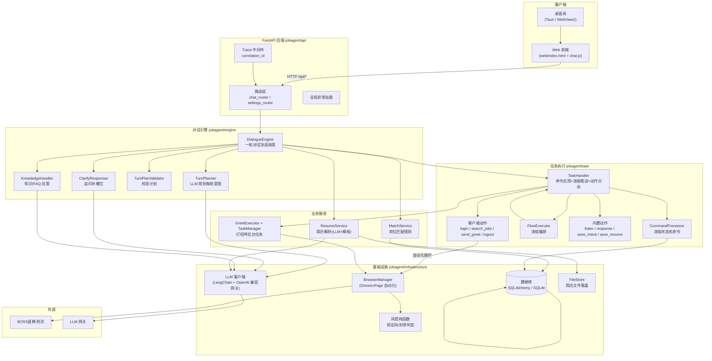
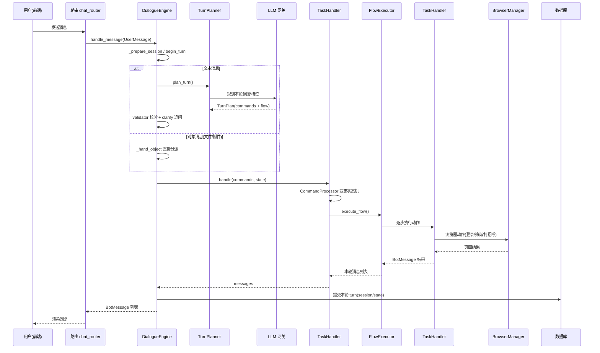

# JobAgent 架构图

> 由 AI 分析 `jobagent/` 源码自动生成（Mermaid）。可直接在 GitHub/GitLab/VS Code 预览渲染。

## 1. 系统总览

## 2. 核心对话链路（一轮消息）

## 3. 模块依赖说明

| 层 | 目录 | 职责 |
|----|------|------|
| API | `jobagent/api` | FastAPI 工厂、路由、异常、静态资源 |
| 引擎 | `jobagent/engine` | DialogueEngine 顶层调度 |
| 规划 | `jobagent/plan` | TurnPlanner 意图规划 + 校验 |
| 任务 | `jobagent/task` | 状态机 + 流程编排 + 动作执行 |
| 服务 | `jobagent/services` | 简历解析、岗位匹配、打招呼后台任务 |
| 领域 | `jobagent/domain` | 消息、状态、上下文数据模型 |
| 基础设施 | `jobagent/infrastructure` | 浏览器、LLM、数据库、文件、风控、日志 |
| 知识 | `jobagent/knowledge` | 知识库应答 |
| 提示词 | `jobagent/prompts` | Jinja2 模板加载与自检 |
